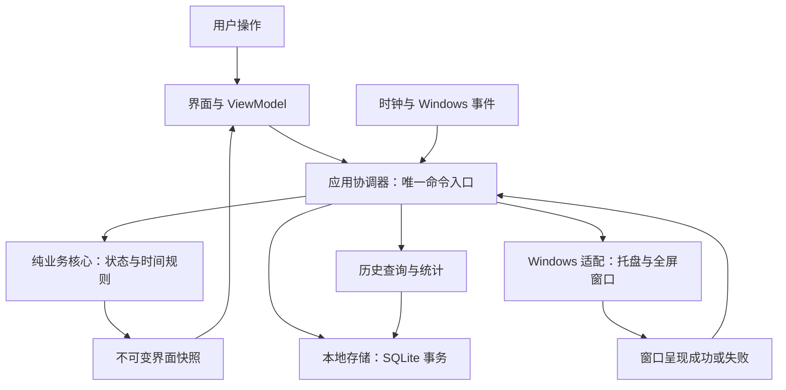

# SandUp · 沙立：交给其他 AI 的开发总览

版本：v0.2 开发基线，2026-11-12规则修订 | 初始日期：2026-10-25 | 本文为设计合同，当前实现状态见docs/delivery。

2026-11-12用户明确调整：设置称为“默认时长”，持久用于以后每轮；3/5分钟延后仅在休息前预警阶段提供，休息开始后不再允许延后。以下合同已同步；旧报告与草图按历史资料保留。

2026-11-19 起，主页支持六项游戏化身体耐久度。每项分别显示今日分与历次有效日结算的加权分。当地零点今日分回满，结算比例见数据合同。应用只用计时和自报活动，六项扣分速度可调。示例见 [使用说明](../user-guide.md)，科学依据见 [文献核查](../research/durability-evidence-20261119.md)，验收见 T36–T39。

## 1. 如何使用这套材料

你负责产品判断；执行 AI 负责实现；验收依据是下面的规则、接口和测试结果。不要把“看起来像草图”当成完成。

| 阅读顺序 | 文件 | 解决的问题 |
| --- | --- | --- |
| 1 | [本总览](./00-开发交接总览.md) | 做什么、用什么技术、什么不能擅自改变 |
| 2 | [流程与状态](./01-流程与状态.md) | 用户操作和异常事件发生后，程序必须怎样变化 |
| 3 | [模块与接口合同](./02-模块与接口合同.md) | 谁负责、调用什么、输入输出和失败处理是什么 |
| 4 | [数据与恢复](./03-数据与恢复.md) | 数据字段、统计口径、保存、崩溃恢复与隐私 |
| 5 | [任务与验收](./04-任务与验收.md) | 分几批做、每批交什么、怎样证明做对了 |
| 6 | [给执行 AI 的任务提示](./05-给执行AI的任务提示.md) | 可复制到其他 AI 的开工指令 |

路径以仓库根目录为基准。所有交接文件应一并提供给执行 AI，不能只发送最后一份提示词。

产品概述见 [一页需求说明 v0.1](../product/healthy-work-clock-requirements-v0.1.md)。静态界面参考位于 `output/wireframes/01-work.png` 至 `05-history.png`。

**冲突优先级：用户后续明确指示 > 本目录 v0.2 的规则与接口 > 一页需求 v0.1 > 界面草图。** 草图中的示例时间、演示逻辑及“暂停”字样不是生产业务规则。不得直接把演示页面改名当成 Windows 成品。

## 2. 产品边界

第一版服务于日常学习和办公：工作计时、休息预告、短暂延后、软全屏休息、活动自报、接续事项、本地历史与导出。用户可立即应急退出。

第一版不做：云账号、云同步、AI 动作识别、强制锁机、健康评分、广告、在线素材加载、复杂任务管理、自动保存其他软件的工作、跨平台移植、自动更新服务。

“轻量”首先体现为范围小、常驻消耗低、无网络依赖；不能仅凭安装包大小或选用原生框架宣称已达标。

## 3. 技术方案

用户已选择 Windows 原生桌面方向。本基线采用：

| 部分 | 选型 | 限制 |
| --- | --- | --- |
| 桌面端 | C#、WPF、.NET 10 LTS | 使用现代 .NET；不用旧版 .NET Framework 模板 |
| 界面组织 | MVVM：界面与界面状态分开 | ViewModel 不写计时规则，不直接操作数据库 |
| 本地数据库 | SQLite，Microsoft.Data.Sqlite | 参数化查询、事务、结构版本迁移；第一版不用大型 ORM |
| Windows 适配 | 独立适配模块封装窗口、显示器、托盘、会话和电源事件 | UI 不直接分散调用系统接口 |
| 自动验证 | 单元测试框架由 M0 确定并锁定，建议 xUnit | 计时测试必须使用可推进的假时钟，不等待真实 25 分钟 |
| 首发范围 | 当前受支持的 Windows 11 x64 | Windows 10、ARM64 暂不承诺支持 |
| 交付形式 | 可解压运行的自包含 x64 包；后续再选安装器 | 用户运行不需安装开发工具；未经实测不宣称任意机器可用 |

选型理由：WPF 是面向 Windows 的桌面 UI 框架；.NET 10 属于 LTS。这里选择它们是为了集中处理 Windows 窗口、托盘和生命周期，不是对资源占用的保证。官方依据：[WPF 概述](https://learn.microsoft.com/en-us/dotnet/desktop/wpf/overview/)、[.NET 支持政策](https://dotnet.microsoft.com/en-us/platform/support/policy)。执行 AI 在 M0 固定实际 SDK 和依赖版本，使用受支持的稳定补丁，不照抄文档页面上的预览版本。

## 4. 总体结构

只有一个应用进程、一个活动轮次、一个状态来源。模块之间是进程内调用，不建 HTTP 接口、后台服务器、消息中间件或多套倒计时。

**流程框表示业务阶段，不要求每个框对应一个类。** 必须固定的是模块边界、公共接口、状态规则和可见结果；模块内部的小函数由执行 AI 自行组织。

## 5. 第一版不可破坏的约束

1. 应急出口优先：关闭遮罩不依赖数据库成功、网络、确认弹窗或活动填写。
2. 同时最多一个活动轮次；多屏只是同一休息的多个窗口，不能生成多份计时或记录。
3. 工作、休息、暂停互斥；系统睡眠、锁屏、遮罩创建等待均不计入工作或休息。
4. 延后次数每轮最多一次；不得因暂停、重启或换显示器重置次数。
5. 休息计时完成与用户勾选活动是两回事；没有填写就是“未记录”。
6. 日期时钟只用于日期和展示；累计时长使用单调计时来源，不能按 UI 刷新次数递减。
7. 所有修改设置只作用于下一轮；当前轮次保存自己的参数快照。
8. 先写入成功，界面才能显示“已保存”。保存失败要可见，但不得困住用户。
9. 自动恢复只能恢复到不计时、不遮屏的状态，不能补算应用未运行期间的工作。
10. 不把行为统计称为健康诊断或真实运动证明。

## 6. v0.2 对原草案的明确化

| 原来容易产生两种理解的地方 | 本开发基线 |
| --- | --- |
| 预告时延后从何时算 | 从原定休息时刻延后：24:40 选择 3 分钟，28:00 才休息 |
| 休息中途延后 | 不提供；休息屏保留应急退出和换提示，延后只在预警阶段使用 |
| 应急退出后的“暂停” | 结束当前轮次并回到待开始；再次开始是新轮次，避免立即重弹 |
| 普通暂停与锁屏 | 保留当前轮次；手动继续后恢复原阶段和剩余时长 |
| 休息完成但没填活动 | 计时结果立刻保存；活动保持未记录，不等待填写才生成记录 |
| 主窗口关闭 | 收起到托盘；托盘有明确“退出应用”。遮罩的关闭操作则等同应急退出 |
| 真实活动时长 | 不推断；只显示“工作计时”“休息屏计时”和自报活动 |
| 自动保存与崩溃 | 明确检查点损失上限和保存状态，不能承诺绝对零丢失 |

参数 25/5 分钟、提前 20 秒挥手、10 秒弹窗、延后 3/5 分钟及每轮一次，继续作为可调整的产品默认值，不是医学处方。执行 AI 应实现这些值，不自行发明其他默认行为。

## 7. 交付次序

M0 工程骨架 → M1 计时核心 → M2 保存与恢复 → M3 Windows 窗口验证 → M4 五个界面整合 → M5 完整验收和运行包。

先让核心规则经过假时钟验证，再接真实窗口；最后验收真实电脑上的睡眠、锁屏、多屏与退出。具体任务及交付证据见 `04-任务与验收.md`。

这些材料能减少 AI 自行猜测，但不能替代验证。验收报告必须区分“实际通过”“未测试”“失败”，不能用一张截图或一句“已完成”代替。

