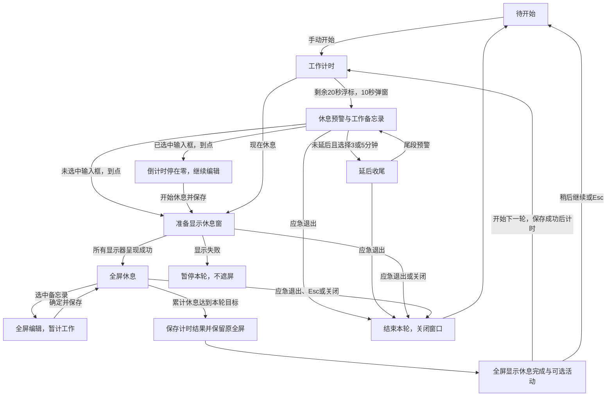
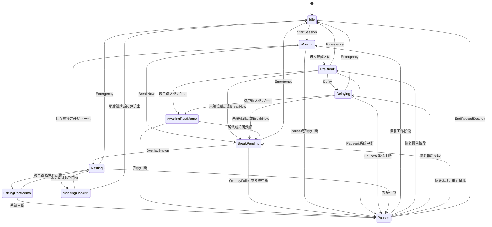

# 流程与状态合同 v0.2

本文是计时业务的唯一规则源。`R-xx` 为规则编号，供接口、代码注释和验收用例引用。

### R-09 可编排循环（v1.10.0 起，v1.11.0 增加组合库）

设置直接显示模块编辑器。初始安排为工作 25 分钟和休息 5 分钟。升级后，旧版固定时长在编辑器中显示为对应的两段，既有组合按原计划读取。组合内可继续放工作、休息或组合。工作为 1–10800 整秒，休息为 1–1800 整秒。新计划最多四层组合，完整一圈最多 512 个工作或休息模块。右侧预览从上到下排列完整一圈，并用颜色和文字区分两类计时模块。每段动作可选择远眺、起身走动或放松肩手。

组合由设置页的组合库创建、编辑和删除。v1.12.0 起组合按“组合1”“组合2”等命名，名称下原位展开新建的空白定义或已有模块。空白定义可以保存，插入前须先添加模块。计划和其他组合引用同一份定义，每处引用独立重复 1–20 次，插入默认 1 次。修改定义会同步预览所有引用，移除一处引用不会删除定义。使用中的组合须先解除全部引用才可删除，组合不可循环引用。只修改未引用的组合时，计时方案与进度沿用原值。

「保存为组合」读取已通过预览校验的完整计划，在组合库草稿中新建定义并展开。顶层模块和引用的顺序及重复次数均复制；嵌套引用仍使用原定义。额外一层超过嵌套深度时，把计划按原顺序展开为工作和休息模块。「合并连续模块」是计划属性。新组合随「保存设置」一并写入。

v1.17.16 起，新计划默认开启「合并连续模块」，已有计划沿用保存的开关选择。展开组合后，相邻工作合成一个总倒计时和一条工作记录，相邻休息也使用一个总倒计时，动作提示仍按原模块时点切换。关闭合并时按各段显示，连续工作仍自动衔接。整个连续休息结束后确认一次活动，再由用户开始下一轮。混合工作与休息的计划在后续循环的衔接处合并同类首尾模块；全工作或全休息的计划仍按圈重复。预览和主页进度使用同一份编排，只在工作即将接休息时预警。

主页用蓝色工作块、绿色休息块显示计划进度。已走完的模块点亮，正在计时或暂停的模块用亮边标记，待完成的模块保持暗色。「现在休息」会结束当前工作模块，实际工作时长按已计时的时间写入。待活动确认时保留刚完成的进度，离开确认后按保存的轮序展示接下来的计划。开场休息只在执行这一段前显示。合并休息沿用设置规则，活动轮使用启动时的计划。

当前轮按启动时的方案运行。修改方案后，从下一轮按新方案的第一轮执行。休息全部完成时推进一次进度，“稍后继续”及以后重开均保留进度。工作或休息尚未完成时应急退出，下一次开始仍处于该轮的位置。暂停、延后、关机恢复、统计与活动确认沿用 R-01 至 R-08 的口径。

2026-11-19 修订身体提醒。主页按眼睛、肩颈、腰背、腹部、臀腿、肛门·前列腺纵向显示六行，每行配图标、今日与历史两条连续分值。今日工作按已保存的实际时间片连续扣分，历史分按部位调节今日扣分倍率。设置可逐项修改基础速度，保存后重算显示，统计页可选更早日期。全屏休息窗遵循系统动画偏好，由沙漏小人按当前提示播放一次动作示范。完成页只预览已选活动在本轮结束日的分数变化，确认后才写入。v1.17.13 起，主页小人保持站姿，在显示且系统允许动画时约每五秒眨一次眼。六条虚线从对应部位附近连到同一行的图标。

本地日期切换时，先以刚结束的有效日实际日末耐久度更新历史，再将新日六项今日分初始化为 100。无记录日历史保持原值。跨午夜专注或休息按原计时继续，窗口跨日与离线后重开均按同一规则显示。

v1.17.14 起，鼠标进入小人脸部时立刻眨一次眼，进入任一手部时对应的手挥一次。每次进入触发一次，手部移动期间悬停范围仍按站姿计算。眨眼和挥手均遵循 Windows 动画设置，离开主页时停止。

v1.8.0 的主页支持离线部位资料卡。鼠标进入图标或名称、键盘聚焦部位时打开。每次仅打开一张，指针移入卡片后可停留阅读。离开该区域且焦点已移走、按 Esc、切页或窗口失活时收起。查看资料不写入活动记录。资料卡依次显示“休息方式”“久坐伏案”“依据”。臀腿图标采用单色轮廓线勾勒侧面迈步的下半身。

2026-11-18记录页改版。进入“记录”默认选中今天，顶部累计工作和休息计时、完成轮次显示所选日期的数据。下方趋势默认显示截至今天的7天，可切换30天。点柱子或用日期选择器同步更新顶部和当日明细。选中区间外日期时，趋势区间以该日期为末日。时长按时间片发生日求和，完成与其他结果按结束日统计，轮次列表按开始日查询。补填活动、刷新、导出和清空仍可从此页操作。

记录页统计所选日期的每轮平均工作与休息时长。只使用已结束轮次的对应实际计时，零工作或零休息分别跳过。跨午夜轮次的整轮时长按结束日进入平均值。当天各休息项目的自报次数按轮次结束日统计，四个活动项目显示各自次数，无自报时显示0次。

2026-11-18用户修订（浮标展示）：浮标为透明背景沙漏。Idle/AwaitingCheckIn时沙子全部在下方。新工作轮次开始时计时立即运行，浮标用约0.8秒翻转180度。翻转过程中沙面保持水平并随玻璃轮廓滑动，接近直立时开始落沙。上部沙量随工作剩余比例减少，下部逐渐堆积。暂停、结束、系统中断或隐藏浮标会结束正在播放的翻转。继续已有轮次时直接显示当前沙量。退出全屏后按当前计时状态显示沙漏。倒计时仅在悬停且未翻转时显示在沙漏内部，鼠标离开即隐藏。双击浮标打开主窗口，开始操作在主窗口完成。

悬浮沙漏窗口为 104 × 104 个逻辑像素。悬停倒计时在下腔以带淡阴影的数字显示，白色玻璃轮廓完整可见。

工作剩余 20 秒且下一模块为休息时，悬浮沙漏保持白色，在原沙漏底部高度站起，长出与主页小人相同的手脚和眼睛，单手挥动，约每三秒眨眼一次。剩余 10 秒时，小人双手挥动，同时出现不抢焦点的预警窗口。剩余 2 秒时停止互动，在约 260 毫秒内收回手脚和眼睛，流沙继续到工作结束。到点进入休息时隐藏浮标。提前休息时，尚未收回的动画与休息流程并行，浮标内容暂停响应鼠标。Windows 动画关闭时直接切换图形。隐藏浮标仍保留 10 秒弹窗。暂停或系统中断时收起预警并停止流沙。延后段末尾使用相同的 20、10 和 2 秒提醒，继续沿用一次延后规则。关闭预警窗口只收起本段提示，本段不再重弹。新轮采用 20 秒 NoticeDurationMs，恢复旧 30 秒参数的轮次保留原参数，界面按当前提醒节奏显示。

主页面保留计时、当前轮次操作与恢复后的活动确认，另设“设置”“记录”入口。工作备忘录位于休息预警与全屏休息。所有参数设置归设置页。历史查询、补填、导出和清空归记录页。切页保留计时状态。

2026-11-20 主页紧凑排版。主页统计显示“今天已工作／已休息”，已结束轮次在记录页查询。保持现有字号，将计时与常用操作并排，沙漏小人居左并以虚线连到六项。v1.17.17 起，面板标题简化为「耐久度」，程序、窗口与托盘图标统一使用主页沙漏小人。按钮为极简图案，保留悬停提示、可访问名称与键盘操作。3/5 分钟延后图案以数字区分。系统原生确认框与托盘菜单使用文字。

## 1. 名词与默认值

- 一轮 Session：从用户开始工作，到休息计时完成、用户应急结束或主动结束这一轮。
- 工作计时：处于 Working、PreBreak、Delaying、AwaitingRestMemo 或 EditingRestMemo 时累计的有效运行时间；不证明实际在工作。
- 休息屏计时：所有目标显示器的休息窗确认显示后，处于 Resting 时累计的时间；不证明离屏或运动。
- 本轮参数：开始时复制的工作时长、休息时长、提前提醒时长和延后选项，不随设置修改。
- 默认工作 1500 秒，休息 300 秒，预告 20 秒；工作可设 1–180 分钟，休息可设 1–30 分钟，整数分钟。
- 第一版延后选项固定 180/300 秒，每轮最多一次；预告 20 秒固定。提示文本与活动目录在安装包内。
- 内部时长用非负整数毫秒；界面倒计时向上取整到秒。到 0 结算定时阶段，备忘录的等待规则见 R-07。统计保留精确值，显示分钟可格式化，不能先四舍五入再求和。

## 2. 用户流程

## 3. 状态机

| 状态 | 计时类型 | 可见界面 | 主要出口 |
| --- | --- | --- | --- |
| Idle | 不计时 | 开始按钮、历史 | StartSession |
| Working | 工作 | 主计时窗或托盘 | PreBreak / Pause / BreakNow |
| PreBreak | 工作 | 非模态小提示；不抢输入焦点 | Delay / BreakNow / 到点 / Emergency |
| Delaying | 工作 | 延后剩余时间与收尾提醒 | BreakNow / 到点 / Pause / Emergency |
| AwaitingRestMemo | 工作（备忘录） | 预警倒计时停在 00:00 | BreakNow / 关闭预警 / Emergency |
| BreakPending | 不计时 | 遮罩创建过程，最长 2 秒 | Resting / Paused / Emergency |
| Resting | 休息屏 | 每块显示器上的软全屏休息窗 | 完成 / 中断 / Emergency |
| EditingRestMemo | 工作（备忘录） | 全屏编辑，休息倒计时暂停 | 确定 / 中断 / Emergency |
| AwaitingCheckIn | 不计时 | 原全屏显示“休息完成”，活动默认未选；恢复时在主窗口展示 | 开始下一轮 / 稍后继续 / Esc |
| Paused | 不计时 | 暂停原因和手动继续按钮 | ResumeSession / EndPausedSession |

`Paused` 必须携带 `resumePhase`、原因和当前轮次；它不是一个全新轮次。`BreakPending` 被打断时，恢复目标为 Resting，但恢复必须先重新请求窗口显示。

## 4. 规则明细

### R-01 唯一时间源与结算

应用协调器持有唯一计时上下文，窗口只订阅快照。每次有效命令先结算当前活动时间段，再进行状态转换。UI 每秒刷新一次即可；后台节拍建议 250 毫秒，但误差不能累计依赖这个频率。

采用可替换的单调时钟测量时长；UTC 时间只做标签与日期拆分。单调时钟本身不等于“自动排除睡眠”，系统事件和缺口检测必须共同处理，不能只换成 Stopwatch 就宣称解决。

正常节拍跨越到期点时，旧阶段计到到期点，不把调度超出的零头直接算成休息。进入 BreakPending 后，直到窗口成功反馈才开始休息计时。一次节拍只能跨到待显示，不允许在后台自动跑完一整个休息轮。

### R-02 预告与延后

1. Working 剩余 ≤ 20 秒且 > 0 时进入 PreBreak，仍算工作。预告不抢焦点、不模拟按键、不拦截输入。
2. PreBreak 选择延后：新工作目标 = 原定工作目标 + 所选时长。例如 24:40 选择延后 3 分钟，剩余 3:20，总工作目标 28:00。
3. 2026-11-12用户修订：延后只允许在PreBreak预警阶段选择。Resting不显示延后按钮，也不接受延后命令；正常休息或应急退出。
4. 延后名额在命令成功接受时使用，不是延后结束时使用；暂停、系统中断、应用重启均不恢复名额。
5. Delaying 不再进入 PreBreak，不允许再次延后。结束前仍按剩余 20 秒挥手、10 秒弹窗提示，弹窗不提供延后按钮。延后结束前“现在休息”按已经实际累计的工作结算，不补算未用完的延后。
6. Working 可“现在休息”，此轮工作只记实际累计；随后的休息目标仍为完整休息时长。

### R-03 暂停与系统中断

普通暂停只在 Working、PreBreak、Delaying 可操作。锁屏、睡眠、远程会话断开、会话切换、异常时间缺口在所有计时阶段都触发暂停；若有遮罩先关闭。恢复桌面或系统唤醒不自动继续。

休息中被系统打断：保留已累计休息，恢复后先重新显示遮罩，成功后继续剩余部分。系统中断不消耗延后名额，也不算完成或跳过。

用于兜底：连续有效节拍相隔超过 3 秒，或者墙上时钟变化与单调差值相差超过 2 秒，或时区改变，冻结到最后可信节拍并进入 Paused，原因 `TimingGap` / `ClockChanged`。不把无法确认的间隔算成工作或休息；此规则可能在严重卡顿时偏保守，界面说明“计时已暂停，请手动继续”。

事件时间戳若已经失去可信性，也按最后可信节拍结算。正常收到的锁屏、睡眠事件则结算到事件时刻。系统事件适配器不得在恢复后把离线差值补回。

### R-04 休息窗口

Windows 适配层为同一用户桌面上每个活动显示器生成一个无边框休息窗口，不使用系统锁屏或 `.scr` 屏保。无需管理员权限，不修改系统锁屏策略。

每个窗口显示同一剩余时间和应急出口。副屏无需独立操作流程；任一屏的退出作用于整轮。休息屏不提供延后。每批窗口有唯一 `overlayBatchId`，过期批次的反馈不能改变新状态。

全部目标屏幕呈现成功才发 `OverlayShown`，开始休息计时。任一屏失败、2 秒内未齐备或意外丢失窗口：关闭这批全部窗口，转 Paused，给出非阻挡错误。不得把部分呈现当作成功。

显示器增减、DPI 或布局变化：休息暂停，旧批次关闭，重新枚举并创建窗口；成功后才继续剩余休息。若检测到锁屏或睡眠，等待用户手动恢复，不能自动重建遮罩。

这是软覆盖：不阻止 Alt+Tab、Win+L、任务管理器和系统安全界面；不反复抢回焦点。Esc 仅在休息窗口接收键盘输入时生效，不注册全局 Esc 钩子。任何休息窗口的关闭操作，包括 Alt+F4，等同应急退出。

### R-05 应急退出和事件竞争

在 PreBreak、Delaying、AwaitingRestMemo、BreakPending、Resting、EditingRestMemo 及全屏 AwaitingCheckIn 提供一键应急退出。普通工作先暂停，暂停页可通过“结束本轮”结束计时。先请求立即关闭对应遮罩，并使其批次失效，再执行数据收尾。

若本轮从未产生有效休息时长，结果为 `Skipped`；若已有有效休息但未正常完成，为 `EndedEarly`。回 Idle，下次开始为新轮。接续事项保留。

命令串行处理。退出/系统中断处理优先于尚未处理的普通节拍；已经提交的 Completed 不回改成跳过。退出与到点同时发生时，只能有一份最终记录，所有遮罩均必须关闭；待显示/待写入的旧回调不能重新弹出。

重复点击、重复系统事件必须幂等。普通业务命令带当前会话与状态版本；过期命令被拒绝并刷新界面。应急关闭通道不等待版本检查，针对旧批次的命令不能结束后来新建的轮次。

### R-06 休息结束与活动确认

休息累计达到目标时停止计时，原子保存计时结果 `Completed` 与待确认状态，活动先存 `Unrecorded`。原全屏批次保持显示，保存后在同一批窗口中切换为“休息完成”。

活动勾选不计时。保存非空活动集合后记 `Reported`；“不记录，继续”或空集合保存保持 `Unrecorded`。没有摄像头、按键监控或运动识别。

“开始下一轮”接受空活动集合。确认后退出全屏，保存事务成功后才启动新一轮。“稍后继续”退出全屏、保存选择并回 Idle。保存失败按 R-08 回到主窗口处理。各屏的复选项可单独勾选，以首次有效提交为准。

Esc、应急退出或关闭任一确认窗会立即收起整批全屏并回 Idle，已完成记录仍为 `Completed`。历史页允许随后补填活动。锁屏、睡眠或显示器变化也会收起全屏，此时待确认项保留在主窗口。

### R-07 工作备忘录与设置

休息前 10 秒的预警弹窗显示选填备忘录，尽量避开悬浮沙漏。若用户未选中输入框，到点直接进入软全屏。若已选中，即使失焦，倒计时到点停在 00:00，等待点击「开始休息」确认。确认时同时保存文字和进入休息状态。关闭预警放弃本次未确认修改，尚未到点时沿用原定时刻，到点后则立即开始休息。

全屏休息显示已保存的备忘录。选中输入框后暂停休息并开始计备忘录工作时间，点击「确定」保存后在原批次继续剩余休息。预警到点后等待确认的时长也作为备忘录工作记入本轮；预警到点前沿用普通工作计时。备忘录最多 200 个 Unicode 文本元素，超限提示并保留可编辑内容。应急退出不等待确认。系统中断后手动继续休息，已保存文字仍可读取；退出编辑状态前未确认的内容不写入。新轮继承已保存备忘录。

设置按 R-09 验证工作、休息与组合模块，再保存成以后的轮次安排。活动轮次继续使用开始时的参数，新计划从下一轮生效。

设置页标题显示已保存、未保存或保存中。用户在仍有修改时主动切页、关闭主窗口或从托盘退出，可选择保存并离开、放弃修改或继续编辑。只有设置写入成功后才更新生效参数；校验或保存失败时保留当前输入与上次保存的参数。放弃修改恢复上次成功保存的值。系统中断后的计时安全和活动确认优先，保留设置草稿。悬浮沙漏开关由独立偏好即时应用。

### R-08 退出、恢复与存储失败

关闭主窗口收起托盘，计时继续；托盘“退出应用”明确结束进程，先关闭所有遮罩，尽力将活动轮次保存为 Paused。正常退出最长等待保存 1 秒，超时给出可见失败状态并允许退出。

重启：进行中的轮次仅恢复为 Paused；已完成但未确认的轮次作为待补记录展示，不显示全屏、不自动开计时。恢复时不读取上次进程的单调时钟基点，不补算停机时长。

计时记录在后台自动保存，主页只在保存异常时显示提示和重试入口。运行中存储失败会冻结当前计时、关闭遮罩、保留内存中的待保存内容；停止接受新轮次，直到重试成功或用户退出。应急关闭和退出始终可用。损坏的数据库不得静默删除重建。

## 5. 界面与命令对应

| 界面 | 用户动作 | 必须调用的业务命令 |
| --- | --- | --- |
| 工作计时 | 开始 / 暂停 / 继续 / 现在休息 | StartSession / PauseSession / ResumeSession / BreakNow |
| 休息预告 | 选中备忘录 / 开始休息 / 延后 / 应急退出 | SetRestMemoEditing / BreakNow / DelayBreak / EmergencyExit |
| 全屏休息 | 选中备忘录 / 确定 / 换提示 / Esc 或关闭 | BeginMemo / ConfirmMemo / SelectPrompt / EmergencyExit |
| 全屏休息完成 | 开始下一轮 / 稍后继续 / Esc 或关闭 | SubmitCheckInAndContinue / SaveCheckInAndStay / EmergencyExit |
| 暂停 | 继续 / 结束本轮 | ResumeSession / EndPausedSession |
| 历史 | 补填活动 / 导出 / 清空 | UpdateHistoricalCheckIn / ExportHistory / ClearHistory |
| 设置 | 保存 | UpdateSettings |

界面不允许自行增减时间、写数据库、根据按钮点击猜测活动完成、因窗口重建重新开始一轮。

