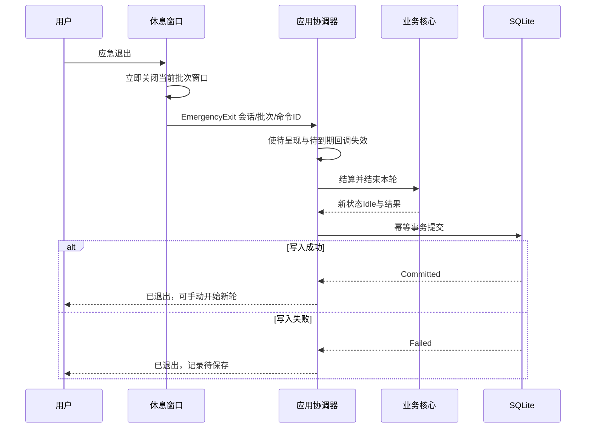

# 模块与接口合同 v0.2

本文中的签名是设计合同，不是已编写的程序。执行 AI 可以采用符合 C# 习惯的具体类型，但不能改变字段含义、前置条件、错误和副作用。

## 1. 模块与目录边界

设置编辑器通过 `UpdateSettings` 保存 `CyclePlan`，其中可包含有序的工作、休息和组合以及休息合并开关。领域层编译编辑树，预览和协调器使用同一规则。协调器保有本轮方案，为全屏窗口发出当前段或合并段的剩余毫秒数、当前提示 ID 及可选的段落说明。主窗口和沙漏从应用快照读取下一轮的工作或休息时长。主页 `PlanProgress` 从同一快照获得有序模块、完成前缀和当前模块标记。所有窗口共用一个计时源。

`UpdateSettings.Arrangement` 保存计划的放置顺序和组合库定义。每个定义有稳定 ID、名称编号和模块序列，每处引用保存目标 ID 和自己的重复次数。`CycleArrangement.Resolve()` 检查重复 ID、重复编号、引用次数、空组合引用、循环引用和嵌套深度，生成计时使用的 `CyclePlan.Blocks`。应用层验证两份数据的执行顺序和内容一致，再随同一次设置更新持久化。计时状态和恢复检查点只使用已解析的执行方案。

```text
src/
  SandUp.Domain/           状态、事件、时间结算、纯规则
  SandUp.Application/      命令协调、快照、恢复编排、统计口径
  SandUp.Infrastructure/   SQLite、文件导出、Windows 系统事件
  SandUp.Desktop/          WPF、ViewModel、托盘、休息窗口
tests/
  SandUp.Domain.Tests/
  SandUp.Application.Tests/
  SandUp.Infrastructure.Tests/
  SandUp.Desktop.Tests/    能自动验证的 UI/窗口逻辑
artifacts/                     构建产物，不提交临时运行数据
docs/development/              本合同与后续决策记录
```

| 模块 | 拥有的责任 | 不允许做的事 | 依赖方向 |
| --- | --- | --- | --- |
| Domain | 一轮的合法状态转换、结算、延后名额、不变量 | WPF、数据库、文件、网络、真实时钟静态调用 | 无业务层之外依赖 |
| Application | 唯一命令队列、去重、调用领域规则、协调保存和窗口、生成快照 | 直接创建 WPF Window、直接写 SQL | Domain、抽象端口 |
| Infrastructure | SQLite 实现、迁移、导出文件、系统事件与真实时钟 | 决定何时开始下一轮、推断运动完成 | Domain/Application 合同 |
| Desktop | 展示、输入验证提示、ViewModel、WPF 窗口呈现、托盘 | 自行计时、自行写记录、自创状态机 | Application 合同 |
| Tests | 假时钟、假窗口、故障注入、合同测试 | 修改生产逻辑绕过未通过测试 | 按被测模块依赖 |

Windows 的“窗口呈现端口”由 Desktop 实现；系统事件采集由 Infrastructure 实现。依赖注入在 Desktop 的唯一启动入口组装。不能让 Application 反向引用 Desktop。

## 2. 关键公共函数

### 2.1 纯业务核心 `ISessionEngine`

| 函数 | 输入 | 输出 | 合同 |
| --- | --- | --- | --- |
| `Reduce(state, event, clock)` | SessionState、SessionEvent、ClockSample | Transition | 纯函数；相同输入得到相同结果；不访问 I/O |
| `Project(state, clock)` | 已结算状态、同一时钟域的时间 | SessionProjection | 只用于界面读数；不创造记录、不改变状态；暂停时不随时钟增加 |
| `Validate(state)` | 任意领域状态 | 违规项集合 | 调试与测试使用；不变量见总览及 `01` |

`Reduce` 执行 R-01～R-06 的时间规则。一个命令可生成多个“变更描述”，例如结束工作时间片、进入待呈现、请求显示遮罩；变更描述本身不是 SQL 或窗口调用。

### 2.2 应用入口 `IWorkClockApplication`

| 函数 | 输入 | 输出 | 调用方与副作用 |
| --- | --- | --- | --- |
| `InitializeAsync()` | 无 | AppSnapshot | 启动迁移和恢复；不会自动计时或显示遮罩 |
| `HandleAsync(envelope)` | CommandEnvelope | CommandResult | UI、托盘共用；所有业务修改串行处理 |
| `ReadSnapshot()` | 无 | AppSnapshot | 无副作用，不能读到正在修改的对象 |
| `SubscribeSnapshots(observer)` | 快照订阅者 | 可释放订阅句柄 | UI 调度到自己的线程；解除订阅后不能泄漏窗口 |
| `PostSystemEvent(event)` | SystemSignal | 无返回业务值 | 系统适配器使用；重复事件安全、打断优先 |
| `RetryPendingSaveAsync()` | 无 | CommandResult | 按原操作 ID 重试，不重复累计；成功后保持暂停，需手动继续 |
| `ShutdownAsync(deadline)` | 最多 1 秒的保存期限 | ShutdownReport | 先关闭遮罩，停止事件订阅和调度，再尽力保存并释放资源 |

每个实例只运行一个命令处理器。不要用“每个按钮一个独立任务直接改共享对象”的方式实现。

`HandleAsync(EmergencyExit)` 在入口处立即使指定遮罩批次失效、取消尚未完成的呈现并请求关闭，再把业务收尾交给高优先级队列。这段关闭路径不排在数据库等待之后。窗口自身也可先调用同一批次的幂等关闭通道；业务状态与记录仍只能由协调器修改。不要把“串行处理”实现成应急按钮必须等待前一个磁盘任务返回。

### 2.3 用户命令表

所有普通修改命令通过 `HandleAsync` 进入。公共前置条件：已初始化、合法参数、会话和状态版本相符、没有待恢复的保存错误。应急关闭、暂停、退出不受保存错误阻断。

| Command | Payload | 前置状态 | 成功结果及副作用 | 主要拒绝原因 |
| --- | --- | --- | --- | --- |
| `StartSession` | 无；使用当前默认设置与草稿 | Idle | 新 SessionId，保存设置快照，进入 Working | InvalidState、StorageUnavailable |
| `PauseSession` | 无 | Working/PreBreak/Delaying | 结算到事件时刻，Paused | InvalidState |
| `ResumeSession` | 无 | Paused；系统处于可用桌面 | 恢复原阶段；休息恢复先 BreakPending | DesktopUnavailable、StorageUnavailable |
| `BreakNow` | 可选 `Memo` | Working/PreBreak/Delaying/AwaitingRestMemo | 结算工作，可保存备忘录，进入 BreakPending | InvalidState、TextTooLong |
| `SetRestMemoEditing` | `Editing` | 有后续休息的工作阶段或 AwaitingRestMemo | 选中时允许预警在到点后保持；关闭预警时恢复原休息流程 | StaleCommand |
| `DelayBreak` | `minutes: 3 or 5` | 仅PreBreak，尚未延后 | 延后次数置 1；Delaying | DelayAlreadyUsed、InvalidArgument、InvalidState |
| `EmergencyExit` | 当前 SessionId、可选 OverlayBatchId | 活动轮次；重复或已结束也可安全调用 | 立即关闭目标遮罩；结束本轮回 Idle | 不因保存失败拒绝关闭；旧会话不修改新会话 |
| `EndPausedSession` | 无 | Paused | 结果 Interrupted、回 Idle；保留草稿 | InvalidState |
| `SaveResumeNote` | `text` | 任意可编辑页面 | 保存工作区草稿；当前轮次同步可选备注 | TextTooLong、StorageUnavailable |
| `SelectPrompt` | `promptId` | Resting | 同批窗口显示同一提示；不改时间或记录 | UnknownPrompt、InvalidState |
| `SubmitCheckInAndContinue` | 已完成 SessionId、`activityIds[]` | AwaitingCheckIn | 原子保存自报内容并创建下一轮，Working | InvalidActivity、StorageUnavailable |
| `SaveCheckInAndStay` | 已完成 SessionId、`activityIds[]` | AwaitingCheckIn | 保存选择，Idle，不启动时钟 | InvalidActivity、StorageUnavailable |
| `DismissCheckIn` | 已完成 SessionId | AwaitingCheckIn | 保留已有计时和已保存活动，Idle | InvalidState |
| `UpdateHistoricalCheckIn` | SessionId、`activityIds[]` | 该会话已结束 | 更新活动与修改时间，不改时长/结果 | SessionNotFound、SessionStillActive |
| `UpdateSettings` | 工作分钟、休息分钟、可选的六项 ReminderRates | 任意 | 原子保存默认时长和扣分速度。省略速度时保留原值。时长用于新轮，分数计算使用当前速度 | InvalidArgument、StorageUnavailable |
| `ClearHistory` | 已确认的明确范围、`includeDraft` | 无进行中的写入 | 只删除已结束轮次及关联记录；当前轮保留 | ConfirmationRequired、StorageUnavailable |

“不记录，继续”就是 `SubmitCheckInAndContinue` 的空集合；不设计含义不同的第二套记录路径。活动列表去重、按目录排序；未知 ID 拒绝，不能悄悄创建活动类型。

预告无独立倒计时对象；历史无另一个写入入口；全屏中的所有按钮也必须经过这些命令。

### 2.4 时钟与系统端口

| 接口函数 | 结果 | 约束 |
| --- | --- | --- |
| `IClock.Read()` | ClockSample | 同次读取给出单调时间、UTC、时区；测试可替换 |
| `IPulseSource.Start(interval, callback)` | 可释放句柄 | 仅触发结算请求，不承担累计计算；生产建议250毫秒 |
| `ISystemSignals.Subscribe(callback)` | 可释放句柄 | 采集锁屏/解锁、休眠/唤醒、会话断开/连接、退出、时钟/时区/显示器变化 |
| `IDisplayTopology.Read()` | DisplayInfo[] | 稳定显示器ID、主屏标记、物理边界、DPI；不能假定坐标从0开始 |
| `ISingleInstance.TryAcquire()` | Primary 或 ExistingInstance | 同一Windows用户仅一个实例；第二次启动只唤出主窗口 |

应用只采集上述系统状态，不采集屏幕、剪贴板、其他软件输入或活动窗口标题。没有鼠标键盘输入不自动判断为离开，避免把阅读误判为休息。

### 2.5 窗口端口 `IBreakOverlayHost`

| 函数 | 输入/输出 | 必须满足的行为 |
| --- | --- | --- |
| `ShowAsync(request, cancellation)` | OverlayRequest → OverlayResult | 为全部目标屏呈现同一批次；完成后返回每屏结果；2秒整体期限 |
| `Update(model)` | OverlayViewModel → 无 | 只更新已有当前批次；不能凭更新消息重新创建已关闭窗口 |
| `CloseAll(batchId, reason)` | 批次或当前批次 → 无 | UI线程快速执行或投递，幂等，无数据库/网络等待；标记批次失效 |
| `SubscribeActions(callback)` | OverlayAction → 可释放订阅 | 按钮、Esc、Alt+F4映射到统一命令；不得各自写业务 |

`ShowAsync` 成功不是“调用过 Show()”，而是所有目标窗口已经完成布局/呈现，退出控件可用。部分失败必须回收全部已创建窗口。关闭后到达的成功回调，只回收旧资源，不可重新进入 Resting。

UI线程不能做数据库、压缩、导出或同步等待；否则“有应急按钮”也可能无法点击。应用不拦截系统切换快捷键。进程崩溃由操作系统移除窗口；第一版不加后台守护进程。

在原窗口更新 `OverlayViewModel.CheckInActivities` 为活动目录后进入“休息完成”。`CheckInLocalDate` 给出本轮结束日，窗口可据此读取一次已保存余量并预览选择。预览读取失败时，确认动作仍可用。`ContinueAfterBreak` 和 `FinishBreakForNow` 随 `OverlayAction.ActivityIds` 提交选择，映射为开始下一轮与稍后继续。提交须校验会话和批次。主窗通过 `AppSnapshot.HasFullscreenCheckIn` 判断确认界面由哪一窗口展示。

休息开始后，`OverlayViewModel.Memo` 给出当前已保存的备忘录。选中输入框发出 `BeginMemo`。应用暂停休息并在同一批次发布 `ConfirmMemo` 能力，当前输入窗口保留文字。确认时随 `OverlayAction.Memo` 提交文本，应用校验批次及会话，保存文本和工作时间后续计休息。

### 2.6 保存端口 `IWorkClockStore`

| 函数 | 输入/输出 | 合同 |
| --- | --- | --- |
| `OpenAndMigrateAsync()` | MigrationReport | 使用事务迁移；失败保留原库并停止新轮次 |
| `LoadAsync()` | PersistedAppState | 只返回已提交数据；不自行恢复到运行态 |
| `CommitAsync(batch)` | AtomicWriteBatch → CommitResult | 参数更新、时间片、会话结果、检查点、命令回执可一次事务提交 |
| `QuerySessionsAsync(query)` | 日期范围/分页 → SessionPage | 上限100条一页；稳定排序，非UI线程查询 |
| `QuerySlicesAsync(range)` | 本地日期范围 → TimeSlice[] | 供统计使用，返回精确毫秒与归属日 |
| `ClearHistoryAsync(request)` | 明确删除范围 → 删除数量 | 与协调器写入屏障配合；事务删除关联数据，不能回写复活 |

`AtomicWriteBatch` 是增改集合，不使用“把整份历史读出后覆盖文件”。活动时间片用稳定ID更新已确认累计值，不能每5秒把整个已累计时长再插入一次。

### 2.7 查询、统计与导出

| 函数 | 输入 | 输出/副作用 |
| --- | --- | --- |
| `IHistoryService.GetDayAsync(localDate)` | 日期 | DaySummary；工作和休息累计、完成/跳过/提前结束/中断次数、活动自报次数 |
| `IHistoryService.GetDaysAsync(range)` | 含首尾的1–30天本地日期范围 | 同一只读快照按日期升序返回DaySummary，空白日期补零。统计字段沿用单日口径 |
| `IHistoryService.GetSessionsAsync(query)` | 日期范围、分页 | SessionPage；显示具体结束原因与未记录状态 |
| `IHistoryService.GetActivitiesAsync(sessionId)` | 已有会话ID | 只读活动自报列表；历史补填页预选已有活动，空列表表示未记录；修改仍通过 `UpdateHistoricalCheckIn` |
| `IHistoryExporter.ExportAsync(request, cancellation)` | 日期范围、用户选择的新导出目录、是否包含接续事项 | ExportReport；两份CSV完整完成后才提示成功，取消不留半成品 |
| `IActivityCatalog.List()` | 无 | 随应用附带的活动定义；只读，无联网 |

导出默认不含接续事项。CSV 使用UTF-8、明确列名、正确转义和文本公式防护。应用不自行写桌面或上传文件。

## 3. 共享数据类型

| 类型 | 必须具备的字段与含义 |
| --- | --- |
| `CommandEnvelope` | CommandId(UUID)、CommandType、Payload、SessionId?、ExpectedViewRevision?；收到时由协调器附加可信ClockSample |
| `CommandResult` | Accepted/Rejected/NoOp、ErrorCode?、AppSnapshot、PersistenceState、可读提示；Accepted不必然等于已落盘，尤其应急命令 |
| `ClockSample` | ProcessClockId、MonotonicTicks、Frequency、UtcNow、TimeZoneId；进程重启换时钟域 |
| `SessionState` | SessionId?、Phase、ResumePhase?、PauseReason?、参数快照、WorkElapsedMs、RestElapsedMs、当前工作目标、DelayUsed、RequestedDelayMs、ActualDelayMs、当前时间片与批次ID、内存时钟锚点 |
| `SessionEvent` | Start、Pause、Resume、BreakNow、Delay、Emergency、EndPaused、Pulse、OverlayShown、OverlayFailed、SystemInterrupted、DisplayChanged；携带事件专属参数 |
| `Transition` | NextState、待保存的时间片与结果变更、SideEffects、拒绝原因?；副作用是描述，不立即执行 |
| `SessionProjection` | 当前阶段、显示剩余毫秒、累计工作/休息毫秒、可用动作集合 |
| `AppSnapshot` | ViewRevision、SessionProjection、当前/待补记录SessionId、接续草稿、默认设置、活动目录、PersistenceState、用户可读通知、AllowedCommands |
| `AtomicWriteBatch` | OperationId、ExpectedStorageRevision、会话/片段/草稿/设置/检查点变更、去重回执；全部成功或全部失败 |
| `PersistedAppState` | StorageRevision、Settings、WorkspaceDraft、CurrentCheckpoint?、待确认记录引用；不包含可跨进程继续使用的单调时间锚点 |
| `CommitResult` | Committed/AlreadyCommitted/Conflict/Failed、NewStorageRevision、可诊断错误；不返回原始SQL到界面 |
| `DisplayInfo` | DisplayId、IsPrimary、PhysicalBounds(left/top/width/height)、DpiX/DpiY |
| `OverlayRequest` | BatchId、SessionId、ViewRevision、Displays[]、剩余休息、当前提示、AllowedActions |
| `OverlayResult` | BatchId、ShownDisplays[]、FailedDisplays[]、AllShown、ErrorCode? |
| `SystemSignal` | Kind、捕获时ClockSample、可选显示器拓扑；不附带用户屏幕内容 |
| `DaySummary` | LocalDate、按发生日累计的WorkMs/RestMs、各结果次数、按结束日归属的WorkRounds/RestRounds、各活动自报轮次数、DataAsOfUtc。Reminder.Levels 和 Reminder.History 各提供六个 0–100 连续分值。History 为该日开始前的加权值。HasRecords 表示本日有有效记录，HistoryDays 为此前全部有效记录日的个数 |
| `SessionQuery` | 日期范围、游标、PageSize(1–100)；无界读取不作为UI默认 |
| `SessionPage` | Items（会话摘要列表）、NextCursor?、DataAsOfUtc；按开始时间降序，再以SessionId稳定排序 |
| `ActivityDefinition` | ActivityId、DisplayName、可选PromptId/Title/Body；`other`只供记录，不生成运动指导 |
| `TimeSlice` | `03`中time_slices的一行；所有日统计以其DurationMs求和 |
| `SettingsSnapshot` | WorkDurationMs、RestDurationMs、NoticeDurationMs、DelayOptionsMs、MaxDelayCount、ReminderRates。旧设置默认使用六项初始速度 |
| `PersistenceState` | Saved / Saving / PendingRetry / Unavailable；同时给出LastSavedAtUtc?与可读失败原因 |
| `ExportRequest` | 日期范围、TargetDirectory（新目录）、IncludeNotes(false)、Format(CsvPair) |
| `ExportReport` | Succeeded/Cancelled/Failed、实际输出目录?、OutputFiles[]、会话数、时间片数、错误码? |

枚举和持久化字段进一步见 `03`。`ViewRevision` 只在逻辑变化时递增，不因每250毫秒的读数刷新递增，避免点击命令无意义地过期。`StorageRevision` 由成功事务递增；二者不可混用。

初版可切换提示固定按 `walk → look_away → relax_shoulders_hands` 循环；其PromptId与ActivityId相同，文案使用草图中的温和说明。选择提示不自动勾选活动。`MigrationReport`包含迁移前后版本、成功状态与错误；`ShutdownReport`包含关窗完成状态、保存是否成功和未保存提示，不需要额外复杂对象模型。

## 4. 必须统一的错误

`InvalidState`、`InvalidArgument`、`StaleCommand`、`SessionNotFound`、`SessionStillActive`、`DelayAlreadyUsed`、`DesktopUnavailable`、`OverlayUnavailable`、`StorageUnavailable`、`StorageConflict`、`CorruptDatabase`、`TextTooLong`、`InvalidActivity`、`UnknownPrompt`、`ConfirmationRequired`、`ExportFailed`。

预期错误返回结构化结果，不能靠未处理异常崩溃。详细异常写脱敏日志，界面用用户能理解的提示。未知错误先关闭遮罩并停止计时，再保留诊断信息。

## 5. 保存、窗口与并发的执行顺序

普通启动/开始休息：校验 → 结算 → 计算下一状态 → 事务保存 → 发布快照 → 执行呈现副作用。只有合法当前批次成功反馈后才能计休息。

暂停、应急和系统中断先使旧批次失效并关窗，再更新状态及事务保存。正常休息完成时冻结休息计时，保留原批次直到用户在全屏完成页作出选择。完成保存失败或用户应急退出时立即关闭全屏窗口。



同一命令ID重试返回原逻辑结果；不能再创建一轮或多加一次完成次数。存储错误保留待提交批次并阻止新轮开始，重试使用同一OperationId。清空历史前排空旧写入，成功后使旧查询与缓存失效。

## 6. 官方技术参考

以下参考提供平台能力，产品规则仍以本合同为准。事件API的存在不代表已覆盖所有睡眠或远程场景，必须实机验证。

- [SystemEvents](https://learn.microsoft.com/en-us/dotnet/api/microsoft.win32.systemevents?view=windowsdesktop-10.0)：Windows会话、电源和显示设置事件入口。
- [Stopwatch](https://learn.microsoft.com/en-us/dotnet/api/system.diagnostics.stopwatch?view=net-10.0)：测量经过时间；睡眠排除另按R-03实现。
- [SQLite原子提交](https://www.sqlite.org/atomiccommit.html)：事务全成或全败的设计依据；不能把文档描述当作任意硬件故障下零丢失保证。

## M0 C# 合同表示约定

`WorkClockCommand` 的各派生类型将命令与载荷绑定，替代可不匹配的 CommandType/object；调用方仍通过 `CommandEnvelope` 和唯一 `IWorkClockApplication` 入口发送。`SessionEvent` 和 `SessionEffect` 使用带参数的派生类型，仅描述事件和副作用，不执行 I/O。`AtomicWriteBatch` 的空活动替换表示清空该会话自报；`CheckpointChange` 的 null、Set、Clear 分别表示不改、写入、清除。设置保存时间和结构版本由 `StoredSettings` 表达。恢复加载当前会话及其片段，检查点不携带跨进程单调锚点。这些是类型映射，不变更 01–03 的业务规则。Desktop `CompositionRoot` 是唯一预留组装入口，M0 明确抛出未实现；真正的协调器和适配器不得由空壳冒充。

`SessionState` 附带内存中的当前片段、下一片段序号及不足一毫秒的单调时钟余数，供纯结算使用；恢复时由已提交片段重建，不把进程时钟锚点或余数持久化。余数的具体运算和跨午夜生成多片段的稳定 ID 方案须在 M1 实现前固定并测试，不能依赖 UI 或随机数使同一输入产生不同输出。

